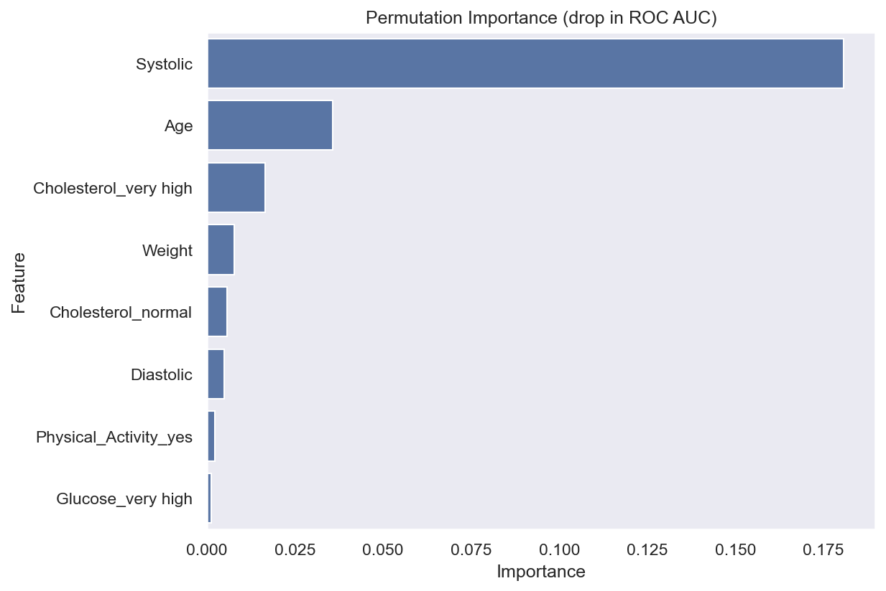
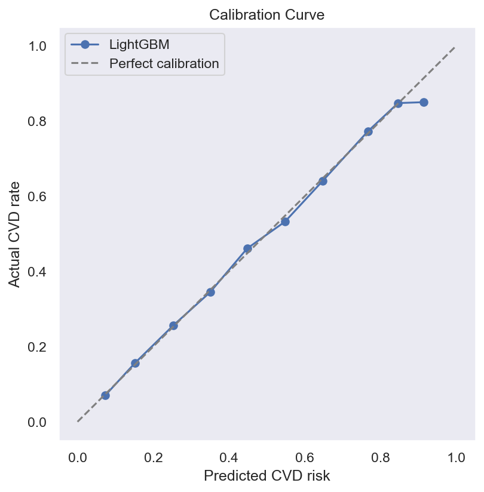
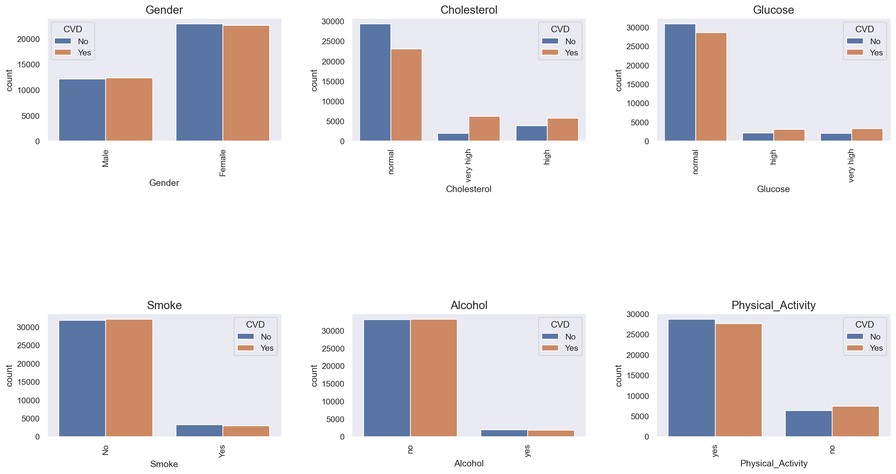
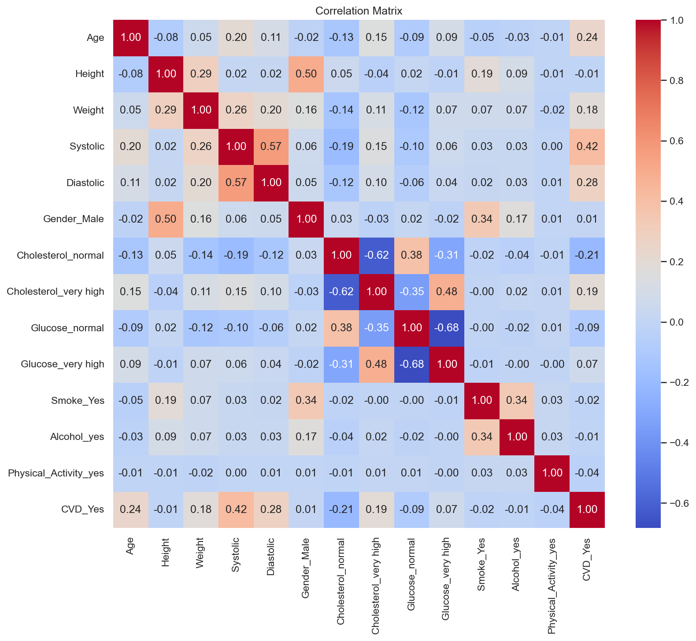

# ❤️ Cardiovascular Disease Prediction with LightGBM (Python Project)

## 📌 Project Overview

This project builds a machine learning model in Python to predict cardiovascular disease (CVD) from routine patient information. It uses 70,000 patient records with age, sex, height, weight, blood pressure, cholesterol, glucose, smoking, alcohol use, physical activity, and CVD status.

The model was trained with LightGBM, a gradient boosting method. The project then went beyond accuracy and tested the model the way a clinical screening tool would be judged. I audited the data for clinically impossible readings, compared the model with a simpler baseline, tuned the decision threshold for screening, checked which features truly drive predictions, and measured whether the predicted risks match real outcomes. Along the way, I found and corrected a reversed sex label in the tutorial's data cleaning.

## 🎯 Key Features

✅ Data Cleaning: Converted age from days to years, fixed negative blood pressure values, and relabeled coded columns. 
✅ Sex Coding Correction: Found that the tutorial reversed the sex labels and corrected them using height, weight, and smoking patterns. 
✅ Exploratory Analysis: Compared CVD rates across sex, cholesterol, glucose, smoking, alcohol, and activity level. 
✅ Clinical Plausibility Audit: Flagged physiologically impossible blood pressure, height, weight, and BMI values. 
✅ LightGBM Model: Trained a gradient boosting classifier on a stratified 70/30 train/test split. 
✅ Baseline Comparison: Compared LightGBM with logistic regression using sensitivity, specificity, and ROC AUC. 
✅ Cross-Validation: Tested the model across 5 folds to confirm stable results. 
✅ Threshold Tuning: Showed the tradeoff between missed CVD cases and false alarms for screening. 
✅ Permutation Importance: Ranked features by how much they actually improve predictions. 
✅ Calibration: Checked whether predicted risk matches the real CVD rate. 
✅ Blood Pressure Staging: Grouped patients by ACC/AHA hypertension stage and compared CVD rates.

## 📷 Visualizations

### Permutation Importance

### Calibration Curve

### CVD by Patient Characteristics

### Correlation Matrix

## 🗂️ Repository Files

| File | Description |
|------|-------------|
| `cardio_data.csv` | Raw dataset: 70,000 rows and 13 columns of patient records |
| `cardiovascular_disease_prediction.ipynb` | Jupyter Notebook with the full code, model, and outputs |
| `permutation_importance.png` | Features ranked by their effect on ROC AUC |
| `calibration_curve.png` | Predicted CVD risk compared with the actual CVD rate |
| `cvd_by_category.png` | CVD status across six patient characteristics |
| `correlation_heatmap.png` | Correlation matrix of the model features |

## 🧹 Data Preparation

- Loaded the data with `pd.read_csv()` using a relative file path, so the notebook runs from any computer.
- Confirmed the dataset has no missing values.
- Converted `Age` from days to years.
- Removed the minus sign from 8 negative blood pressure readings, then capped systolic at 60 to 200 mmHg and diastolic at 50 to 180 mmHg.
- **Corrected the sex coding.** The tutorial mapped code 1 to male, but code 1 patients averaged 161.4 cm tall with a 1.8% smoking rate, while code 2 patients averaged 169.9 cm with a 21.9% smoking rate. Code 2 is men, so the labels were reversed. After the fix, the dataset has 45,530 women and 24,470 men.
- Encoded categorical columns with `pd.get_dummies(drop_first=True)`.
- Confirmed the target is balanced: 35,021 patients without CVD and 34,979 with CVD.
- Split the data 70/30 with `stratify=y` and `random_state=23`.

## 🛠️ Skills & Tools Applied

- Language and Environment: Python, Jupyter Notebook (Anaconda)
- Libraries: pandas, NumPy, Matplotlib, Seaborn, scikit-learn, LightGBM
- Models: LightGBM (gradient boosting), logistic regression (baseline)
- Evaluation: Accuracy, precision, sensitivity (recall), specificity, ROC AUC, Brier score
- Validation: Stratified train/test split, 5-fold cross-validation, clinical plausibility audit
- Interpretation: Permutation importance, calibration curve, threshold analysis
- Clinical Knowledge: Blood pressure staging, physiologic plausibility, screening tradeoffs

## 📈 Business Questions Answered

This project provides insights into:

- How well can routine patient data predict cardiovascular disease?
- Does a complex model beat a simple one?
- How many CVD cases does the model miss, and how can that be reduced?
- Which risk factors drive the predictions?
- Can the model's risk scores be trusted as real probabilities?
- Is the data clinically valid?

## 💡 Key Insights

### Model Performance

- LightGBM reached **73.4% test accuracy** (75.1% on training data), with **75.4% precision** and **69.3% sensitivity**.
- **5-fold cross-validation** averaged a **ROC AUC of 0.802**, with every fold between 0.797 and 0.811, so the results are stable.

| Model | Accuracy | Sensitivity | Specificity | ROC AUC | Missed CVD Cases |
|---|---|---|---|---|---|
| Logistic Regression | 72.6% | 67.4% | 77.8% | 0.789 | 3,426 |
| LightGBM | 73.4% | 69.3% | 77.4% | 0.802 | 3,221 |

- LightGBM beat logistic regression on accuracy, sensitivity, and AUC, and caught **205 more CVD cases**. The gain was modest, which shows a simple model already captures much of the signal.

### Clinical Plausibility Audit

| Check | Records Found |
|---|---|
| Systolic outside 70 to 250 mmHg | 222 |
| Diastolic outside 40 to 150 mmHg | 1,033 |
| Diastolic equal to or higher than systolic | **1,230** |
| Height under 120 cm | 52 |
| Weight under 30 kg | 7 |
| BMI under 13 or over 60 | 76 |

- **1,230 patients had a diastolic pressure equal to or higher than their systolic pressure**, which is physiologically impossible.
- In total, **1,409 records (2.0%)** failed at least one check.
- Retraining without them gave nearly identical results (73.7% accuracy, 0.802 AUC). The model was robust to these errors, but a clinical model should still exclude them.

### Threshold Tuning for Screening

| Threshold | Sensitivity | Specificity | Missed CVD Cases | False Alarms |
|---|---|---|---|---|
| 0.50 (default) | 69.3% | 77.4% | 3,221 | 2,374 |
| 0.40 | 78.6% | 66.5% | 2,241 | 3,521 |
| 0.35 | 83.6% | 58.5% | 1,725 | 4,360 |
| 0.30 | 87.6% | 49.4% | 1,299 | 5,315 |
| 0.25 | 92.9% | 36.7% | 746 | 6,653 |

- At the default threshold, the model **missed 31% of patients with CVD**.
- Lowering the threshold to **0.35** raised sensitivity to **83.6%** and cut missed cases nearly in half (from 3,221 to 1,725), at the cost of more false alarms.
- For screening, a missed case usually costs more than a false alarm, so a lower threshold is often the better choice.

### What Drives the Predictions

- **Systolic blood pressure was the strongest predictor by a wide margin.** Shuffling it lowered the AUC by about 0.18.
- **Age** (0.036) and **very high cholesterol** (0.016) were next, followed by weight and diastolic pressure.
- LightGBM's default importance chart ranked **weight and height** at the top, because it counts how often a feature is used to split, which favors features with many values. Permutation importance gave a ranking that matches clinical knowledge.

### Blood Pressure Stage and CVD

| ACC/AHA BP Stage | CVD Rate | Patients |
|---|---|---|
| Normal | 22.2% | 9,608 |
| Elevated | 32.4% | 3,125 |
| Stage 1 hypertension | 38.5% | 32,561 |
| Stage 2 hypertension | **78.2%** | 24,706 |

- CVD rose with every blood pressure stage. **Stage 2 hypertension carried about 3.5 times the CVD rate of normal blood pressure.**

### Calibration

- The model had a **Brier score of 0.180**, and its predicted risks closely matched real outcomes. For example, patients predicted at about 25% risk had a 25.6% actual CVD rate.
- Only the highest-risk group was slightly overconfident (about 91% predicted vs. 85% actual).

*Note: The blood pressure capping in the tutorial's cleaning step may turn data entry errors (such as 16,020 instead of 160) into extreme but valid-looking values. The plausibility audit was run on the raw values to catch these. The dataset does not include diagnosis dates or follow-up, so the model identifies patients who have CVD rather than predicting future risk. This project is for learning purposes and is not a clinical tool.*

## 🚀 Learning Outcomes

Building this project strengthened my skills in:

📌 Cleaning medical data and catching coding errors with clinical reasoning 
📌 Training and evaluating a gradient boosting model 
📌 Comparing a complex model against a simple baseline 
📌 Using sensitivity and specificity, the metrics clinicians rely on 
📌 Tuning a decision threshold for a screening use case 
📌 Explaining model predictions with permutation importance 
📌 Checking whether predicted risks are well calibrated

## 🔮 Next Steps

- Remove implausible records before training instead of capping them.
- Add BMI and blood pressure stage as model features.
- Check performance across subgroups such as age and sex to look for groups the model serves poorly.
- Tune LightGBM with cross-validated hyperparameter search.
- Use SHAP values to explain individual patient predictions.

## 📚 Dataset Source

Based on the [Cardiovascular Disease Dataset](https://www.kaggle.com/datasets/sulianova/cardiovascular-disease-dataset) by Svetlana Ulianova on Kaggle, using a cleaned version with labeled categories.

## 🙌 Acknowledgment

This project taught me that a working model is only the starting point in healthcare. Asking clinical questions, such as whether the readings are possible, which patients are missed, and whether the risk scores can be trusted, turned a tutorial model into something closer to how a real screening tool is judged.

## 🔗 Related Link

[LinkedIn Post](https://www.linkedin.com/feed/update/urn:li:activity:7528349586646618113/)

## 👨‍💻 Author

**Omar Shazley**: Data Analyst | Python, Excel, SQL, and healthcare data analytics

💼 [LinkedIn](https://www.linkedin.com/in/omar-shazley-914a16b1/) 
💻 [GitHub Portfolio](https://github.com/Bromar95) 
📧 Email: [omarshazley@gmail.com](mailto:omarshazley@gmail.com)

✨ If you like this project, don't forget to ⭐ star the repo!
